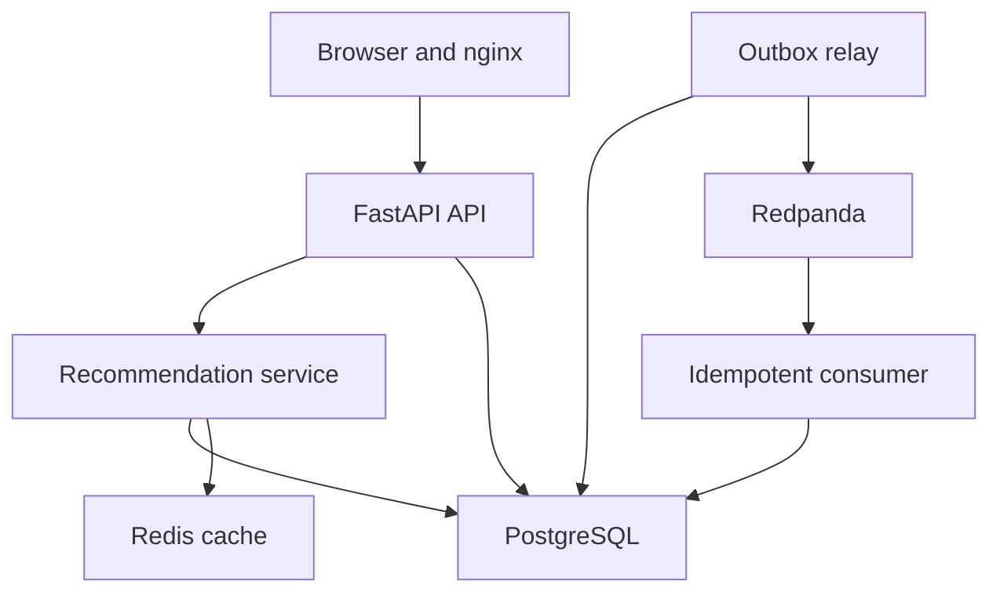

# Runtime architecture

API acceptance commits canonical event, outbox and global cache version atomically. Relay leases pending work using row locks and skip-locked claims, publishes with acknowledgment, then records completion using its lease token. Lease expiry permits safe re-delivery; consumer ledger and projection update commit atomically. Durable quarantine precedes offset advancement for poison events. This is at-least-once delivery, not exactly-once transport.
The recommendation service reads raw user history and projected cross-user signals under repeatable-read. Consumer updates increment cache version. Redis keys include model/user/limit/version and expire in 60 seconds. Redis errors fall back to computation. PostgreSQL remains authoritative.
The global snapshot and single version counter suit this small catalog. They are scaling limits: every event invalidates all user caches, inference reads all projected user-item rows, and event history has no pagination. These are documented engineering limits, not benchmarked scalability claims.
